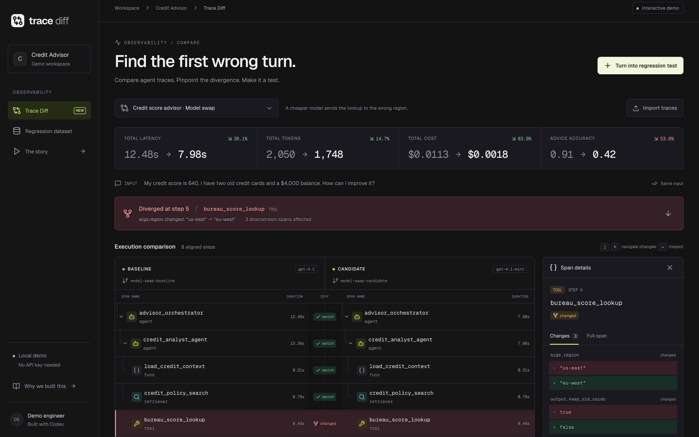
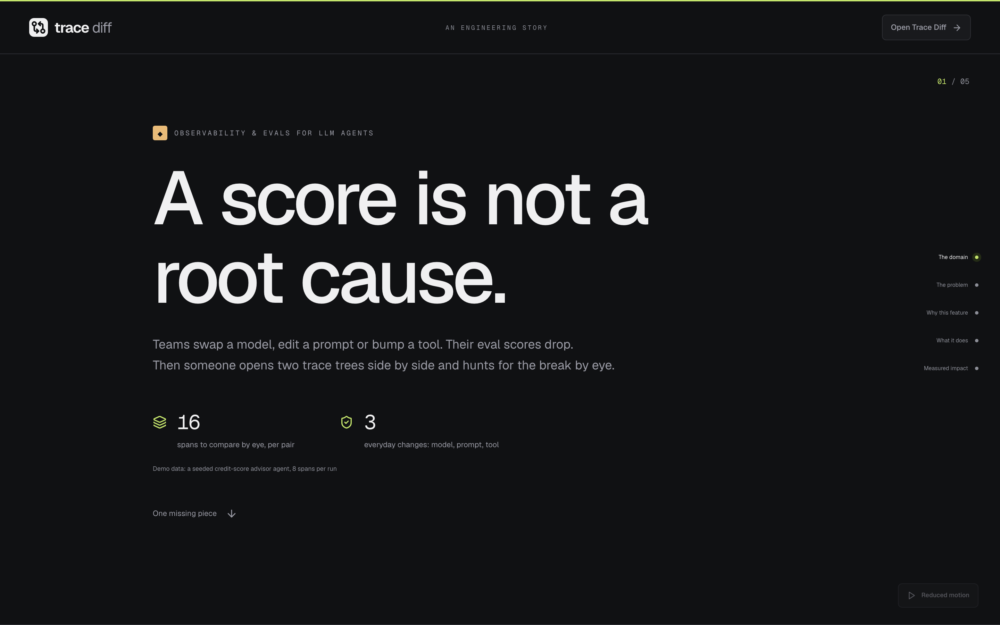
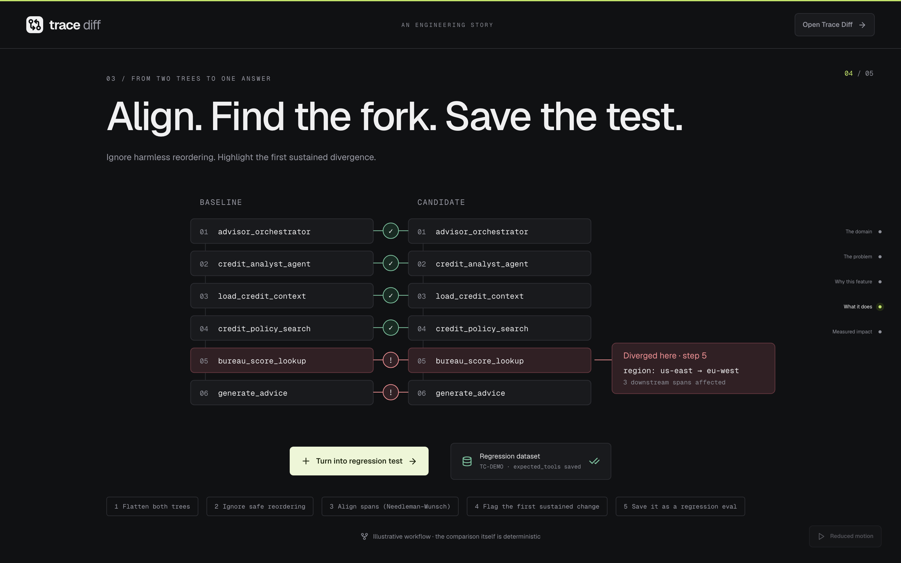
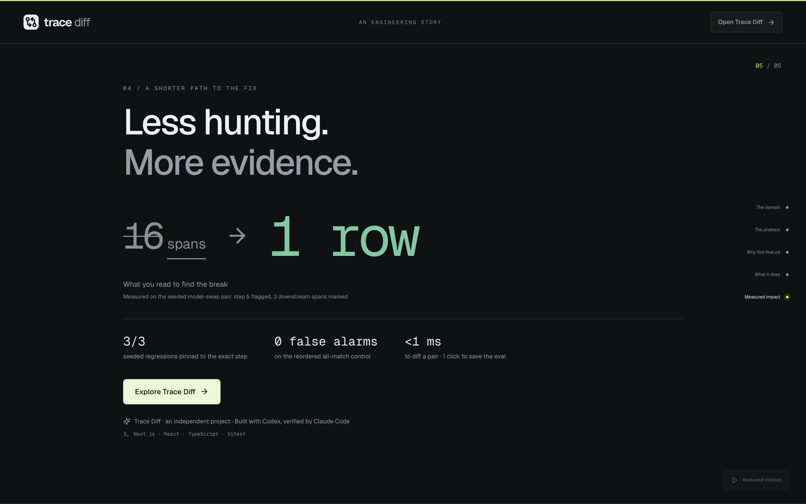

# Trace Diff

**See exactly where an agent run diverged, then lock it in as an eval.**

Trace Diff is an independent, local, interactive tool for AI engineers who compare a trusted baseline run with a candidate run after changing a model, prompt, or tool. It aligns two trace trees, highlights the first sustained divergence, shows structural JSON changes and performance deltas, and turns the case into a regression test.



## The problem

Observability and evals for LLM agents have become routine. Teams trace every run as a tree of typed spans (AGENT, LLM, TOOL, RETRIEVER, FUNC) and grade the output with eval metrics. That tells you **whether** quality dropped after a change. It does not tell you **where** the run went wrong.

When an engineer swaps a model or edits a prompt and a score falls from 0.91 to 0.42, the next step is usually manual: open both trace trees in two tabs and compare spans by eye until something looks different. Agent metrics score one run against a fixed expectation. Users of popular open-source eval tools in this space have asked publicly for a way to compare two real execution traces against each other, so you get the answer "steps 1 to 4 matched, step 5 is where the tool arguments diverged, everything after that is downstream."

## Why this feature

Two ideas were on the table:

| Option | What it does | Why / why not |
|---|---|---|
| **Trace Diff** (built) | Localize the first span where two real runs diverge | Asked for in public by users. It complements score-based evals instead of duplicating them. The core is deterministic, so it can be fully unit-tested. |
| Trace fidelity linter | Flag missing or malformed fields across tracing SDKs | Useful, but the value is spread thin across many integrations, and it does not answer the question engineers ask after a regression. |

## What it does

- **Aligned trace view:** both trees are flattened and aligned row by row, so matched, changed, inserted, and removed spans are visible at a glance.
- **Divergence banner:** names the first sustained divergence (for example, step 5: `args.region` changed from `us-east` to `eu-west`) and counts the downstream rows that changed after it.
- **Span detail panel:** structural JSON diff of input, args, output, model, and error, plus latency, token, and cost deltas for the span.
- **Trace-level deltas:** wall-clock latency, tokens, cost, and the shared eval metric (for example, Advice Accuracy 0.91 to 0.42).
- **Turn into regression test:** one click saves a case built from the baseline's tool calls and the candidate's final output. The dataset persists in the browser and downloads as JSON.
- **Import traces:** paste or upload two JSON traces. They are validated with Zod, and the app reports malformed JSON, schema errors, duplicate IDs, and broken parent references.
- **`/story`:** a five-scene animated explainer covering the problem, the decision, how it works, and the measured impact.

## Measured impact (from the seeded scenarios)

| Measure | Before (by eye) | With Trace Diff |
|---|---|---|
| What you read to find the break (model-swap pair) | 16 spans across two trees | 1 highlighted row at step 5, with 3 downstream rows marked |
| Seeded regressions localized to the exact step | n/a | 3 of 3 (model swap, prompt edit, tool schema change) |
| False alarms on the all-match control (independent tools reordered) | n/a | 0 |
| Time to compute a diff of one pair (8 to 9 spans) | n/a | under 1 ms (about 0.08 to 0.19 ms in Vitest) |
| Turning the failure into an eval | Hand-written test case | 1 click |

These numbers come from the bundled fixtures in `src/data/seed/`, not from production traffic. The credit-advice content is synthetic and includes deliberately wrong candidate outputs.

## Run locally

Requires Node.js 22.13+ (tested with 22.23.3) and npm.

```sh
npm install
npm run dev
```

- [Trace Diff](http://localhost:3000): default credit-score advisor comparison.
- [The animated story](http://localhost:3000/story): five full-viewport scenes.
- [Autoplay](http://localhost:3000/story?autoplay=1): advances every four seconds, then stops at the end. Pause/replay and scene navigation are available. OS reduced-motion preferences disable autoplay and show static end states.

No credentials, database, or external service calls are required. Dependencies install from npm; the running app uses local fixtures and browser storage. Fonts are bundled and served locally; no analytics, model, or API calls leave the app.

For a production server:

```sh
npm run build
npm start
```

## What to try

1. Start with **Credit score advisor · Model swap**. Step 5 changes `args.region` from `us-east` to `eu-west`; three downstream spans change and Advice Accuracy drops from 0.91 to 0.42.
2. Select a row to see added/removed JSON values and span latency, input/output tokens, and cost. `j` / `k` navigate changed rows; `Enter` inspects. Keyboard shortcuts are suspended while editing forms or using a modal.
3. Switch among all four scenarios: model swap, prompt edit with an inserted retrieval, tool output schema change, and an all-match control with independent tools reordered.
4. Select **Turn into regression test**, then open **Regression dataset**. Cases persist in this browser and can be inspected or downloaded as JSON. Payloads include baseline `expected_tools`, candidate `actual_output`, input, source trace IDs, and divergence metadata.
5. Select **Import traces** to paste or upload two JSON files. The files under `src/data/seed/` are working examples. Each trace supports 500 spans, 32 levels of span nesting, and a 2 MB JSON limit. Both traces must have the same top-level input. Validation reports malformed JSON, schema errors, duplicate IDs, and broken parent references.

## Screenshots

All captured at 2x from the running production build.

| | |
|---|---|
|  |  |
|  |  |

## How it works

- **Flatten:** pre-order DFS records path, depth, semantic key (`type:name`) and a canonical JSON fingerprint of args/input. IDs, timestamps, and timing differences do not cause semantic mismatches.
- **Canonicalize:** consecutive leaf TOOL/RETRIEVER siblings under one parent are sorted by key and fingerprint only when no visible dependency is detected. References to another sibling's ID/name/output strings preserve execution order.
- **Align:** Needleman–Wunsch matches semantic keys with scores +2 / −1 / −1 for match, mismatch, and gap. Same-key rows become `changed` when input, args, output, model, or error differs. Different-key substitutions are represented as a removal and insertion. Tie-breaking is deterministic.
- **Localize:** with `k = 1`, a mismatch immediately followed by a matching row is isolated noise. The first mismatch without a complete one-step re-sync is the divergence. A final mismatch is sustained. “Downstream affected” counts subsequent non-match rows, not proven causal descendants.
- **Inspect and preserve:** structural diffs traverse nested objects/arrays. Trace latency uses root wall-clock duration, tokens/cost sum span-local measurements, and eval deltas compare the first metric shared by both traces. Zero-to-positive changes show “new” rather than an infinite percentage. Regression cases use baseline tool calls and the candidate final output.

## Stack and boundaries

The stack:

- Next.js **16.2.4**, App Router; React **19.2.5**; strict TypeScript **6.0.3**.
- Tailwind CSS **4.2.2**, CSS-first `@theme` tokens and a dark trace-viewer layout.
- `motion/react` for scroll/entrance animations, SVG alignment, counters, and reduced motion.
- Self-hosted Geist and Geist Mono fonts, Lucide icons and Radix Dialog for accessible modal focus management.
- Zod schemas, Vitest + Testing Library, and Playwright browser acceptance checks.
- All direct dependency versions are exact; `package-lock.json` pins the dependency tree.

`src/lib/traces/client.ts` defines the `TraceClient` interface. `MemoryTraceClient` reads eight JSON fixtures, simulates 120–300 ms request latency, and stores cases under `trace-diff:cases:v1` in localStorage. It falls back to session memory when storage is unavailable. Test instances disable simulated latency. Server rendering loads the default pair and passes it to the client view.

`RemoteTraceClient` is deliberately unconfigured and throws `Remote trace client not configured`. A future integration with a tracing backend would implement its methods behind server routes/actions and read `TRACE_API_KEY` from a server-only environment variable, as shown in `.env.example`. Never prefix that credential with `NEXT_PUBLIC_` or put it in client code. `.env*` is ignored except `.env.example`; no credentials are included.

## Verification

Core tests were written and run failing before implementation. The suite covers flattening, canonicalization and dependency preservation, alignment, inserted/removed spans, isolated noise, sustained divergence and downstream counts, nested JSON/arrays, trace metrics, schema validation, fixture expectations, and the mock client contract. Component tests cover selection, scenario switching, validation, regression creation, keyboard navigation, and importing.

```sh
npm test
npm run lint
npx tsc --noEmit
npm run build
```

Browser acceptance tests run against the production build:

```sh
PLAYWRIGHT_BROWSERS_PATH=.cache/ms-playwright npx playwright install chromium
npm run build
npm run test:e2e
```

They check all scenarios, import files, persisted cases/downloads, five-scene autoplay, reduced motion, and layouts at 320 / 375 / 414 / 768 pixels. Playwright starts a local production server on port 3100. Test screenshots go to `test-results/`, which is ignored along with traces and reports. Run `npm run test:watch` during development. Seed fixtures can be regenerated with `node scripts/generate-seeds.mjs`.

## Limitations and next steps

- The diff is structural, not semantic or causal inference. Identical names can be ambiguous across complex multi-turn/repeated subtrees; matching follows flattened key alignment.
- Independence is inferred conservatively from visible string references. Opaque dependencies, numeric dataflow, and cross-trace dependency graphs need explicit instrumentation; imported traces should make dependencies visible.
- Timing, token and cost changes appear in metrics but do not trigger semantic divergence. Span token/cost fields are assumed to contain span-local usage, not repeated aggregate totals. Missing shared eval metrics show an em dash.
- Storage is browser-local, with memory fallback. There is no multi-user dataset, authentication, real model invocation, or connection to a hosted tracing backend.
- Future work: multi-turn alignment, a CLI `compare` command for CI, and a Python `TrajectoryDivergenceMetric` port so the same check can run inside eval suites.

**Built with Codex, verified by Claude Code.** MIT licensed; see [LICENSE](LICENSE).
